# Modelo entidad-relación aplicado

Generado del esquema PostgreSQL vigente. Migración: `0011_pricing_rules`. Los vínculos representan claves foráneas reales.

```mermaid
erDiagram
    audit_logs {
        bigint id
        bigint company_id
        bigint user_id
        character_varying entity_id
    }
    auth_rate_limits {
    }
    bayes_analyses {
        bigint id
        bigint company_id
        bigint analysis_id
    }
    branch_inventory {
        bigint company_id
        bigint branch_id
        bigint product_id
        numeric quantity
    }
    branches {
        bigint id
        bigint company_id
        character_varying code
        character_varying name
    }
    categories {
        bigint id
        bigint company_id
        character_varying name
    }
    companies {
        bigint id
        character_varying name
    }
    customers {
        bigint id
        bigint company_id
        character_varying name
    }
    dataset_variables {
        bigint id
        bigint company_id
        bigint dataset_id
        character_varying name
        character_varying data_type
    }
    datasets {
        bigint id
        bigint company_id
        character_varying name
    }
    employees {
        bigint id
        bigint company_id
        bigint user_id
        bigint branch_id
    }
    insights {
        bigint id
        bigint company_id
        bigint analysis_id
        character_varying status
    }
    inventory {
        bigint company_id
        bigint product_id
        numeric quantity
    }
    inventory_movements {
        bigint id
        bigint company_id
        bigint product_id
        bigint sale_id
        bigint branch_id
    }
    observations {
        bigint id
        bigint company_id
        bigint dataset_id
        bigint variable_id
    }
    order_details {
        bigint id
        bigint company_id
        bigint order_id
        bigint product_id
        numeric quantity
    }
    orders {
        bigint id
        bigint company_id
        bigint customer_id
        character_varying status
        numeric total
        bigint sale_id
        bigint branch_id
    }
    payments {
        bigint id
        bigint company_id
        bigint sale_id
        character_varying status
    }
    products {
        bigint id
        bigint company_id
        bigint category_id
        character_varying name
    }
    random_variables {
        bigint id
        bigint company_id
        character_varying name
    }
    reports {
        bigint id
        bigint company_id
    }
    roles {
        bigint id
        character_varying code
        character_varying name
    }
    sale_details {
        bigint id
        bigint company_id
        bigint sale_id
        bigint product_id
        numeric quantity
    }
    sales {
        bigint id
        bigint company_id
        bigint customer_id
        bigint seller_id
        character_varying status
        numeric total
        bigint branch_id
    }
    statistical_analyses {
        bigint id
        bigint company_id
        bigint dataset_id
        character_varying analysis_type
    }
    statistical_results {
        bigint id
        bigint company_id
        bigint analysis_id
        bigint variable_id
    }
    users {
        bigint id
        bigint company_id
        bigint role_id
    }
    companies ||--o{ audit_logs : "audit_logs_company_id_fkey"
    users ||--o{ audit_logs : "audit_logs_company_id_user_id_fkey"
    statistical_analyses ||--o{ bayes_analyses : "bayes_analyses_company_id_analysis_id_fkey"
    branches ||--o{ branch_inventory : "branch_inventory_company_id_branch_id_fkey"
    products ||--o{ branch_inventory : "branch_inventory_company_id_product_id_fkey"
    companies ||--o{ branches : "branches_company_id_fkey"
    companies ||--o{ categories : "categories_company_id_fkey"
    companies ||--o{ customers : "customers_company_id_fkey"
    datasets ||--o{ dataset_variables : "dataset_variables_company_id_dataset_id_fkey"
    companies ||--o{ datasets : "datasets_company_id_fkey"
    users ||--o{ datasets : "datasets_company_id_created_by_fkey"
    branches ||--o{ employees : "fk_employees_branch"
    companies ||--o{ employees : "employees_company_id_fkey"
    users ||--o{ employees : "employees_company_id_user_id_fkey"
    statistical_analyses ||--o{ insights : "insights_company_id_analysis_id_fkey"
    products ||--o{ inventory : "inventory_company_id_product_id_fkey"
    branches ||--o{ inventory_movements : "fk_inventory_movements_branch"
    products ||--o{ inventory_movements : "inventory_movements_company_id_product_id_fkey"
    sales ||--o{ inventory_movements : "inventory_movements_company_id_sale_id_fkey"
    users ||--o{ inventory_movements : "inventory_movements_company_id_created_by_fkey"
    dataset_variables ||--o{ observations : "observations_variable_id_fkey"
    datasets ||--o{ observations : "observations_company_id_dataset_id_fkey"
    orders ||--o{ order_details : "order_details_company_id_order_id_fkey"
    products ||--o{ order_details : "order_details_company_id_product_id_fkey"
    branches ||--o{ orders : "fk_orders_branch"
    companies ||--o{ orders : "orders_company_id_fkey"
    customers ||--o{ orders : "orders_company_id_customer_id_fkey"
    sales ||--o{ orders : "orders_company_id_sale_id_fkey"
    users ||--o{ orders : "orders_company_id_created_by_fkey"
    sales ||--o{ payments : "payments_company_id_sale_id_fkey"
    categories ||--o{ products : "products_company_id_category_id_fkey"
    companies ||--o{ products : "products_company_id_fkey"
    companies ||--o{ random_variables : "random_variables_company_id_fkey"
    users ||--o{ random_variables : "random_variables_company_id_created_by_fkey"
    companies ||--o{ reports : "reports_company_id_fkey"
    users ||--o{ reports : "reports_company_id_created_by_fkey"
    products ||--o{ sale_details : "sale_details_company_id_product_id_fkey"
    sales ||--o{ sale_details : "sale_details_company_id_sale_id_fkey"
    branches ||--o{ sales : "fk_sales_branch"
    companies ||--o{ sales : "sales_company_id_fkey"
    customers ||--o{ sales : "sales_company_id_customer_id_fkey"
    employees ||--o{ sales : "sales_company_id_seller_id_fkey"
    users ||--o{ sales : "sales_company_id_created_by_fkey"
    datasets ||--o{ statistical_analyses : "statistical_analyses_company_id_dataset_id_fkey"
    users ||--o{ statistical_analyses : "statistical_analyses_company_id_created_by_fkey"
    dataset_variables ||--o{ statistical_results : "statistical_results_variable_id_fkey"
    statistical_analyses ||--o{ statistical_results : "statistical_results_company_id_analysis_id_fkey"
    companies ||--o{ users : "users_company_id_fkey"
    roles ||--o{ users : "users_role_id_fkey"
```

Nota: las relaciones opcionales se validan con columnas nullable; el diagrama resume cardinalidades de referencia. SQL y migraciones contienen las reglas completas.